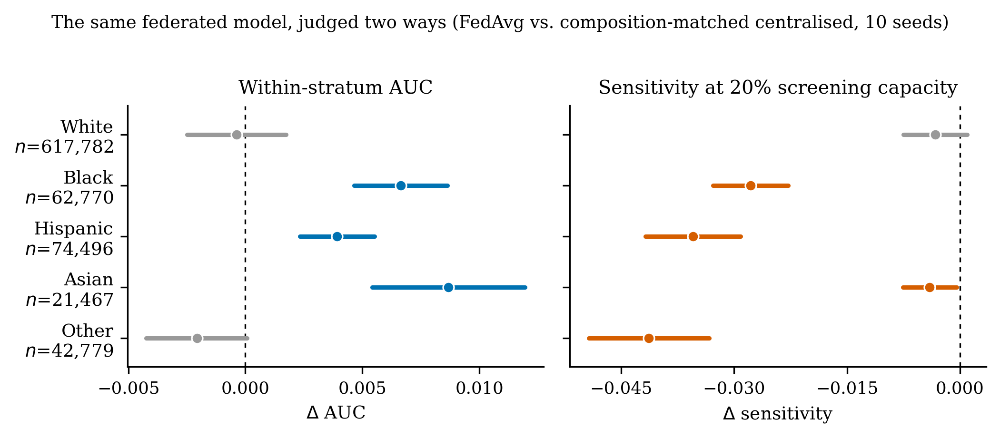
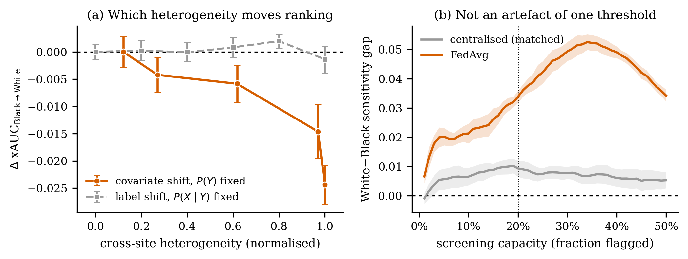

# Privacy-Preserving Federated Learning for Diabetes Risk Prediction

What if hospitals could collaborate on a shared diabetes model without sharing a single patient record?

[](https://www.python.org)
[](https://pytorch.org)
[](https://flower.dev)
[](https://opacus.ai)
[](LICENSE)
[](https://ahli.cc/ml4h/)
[](https://doi.org/10.5281/zenodo.21739555)
**Author:** Rajveer Singh Pall  
**Affiliation:** Gyan Ganga Institute of Technology and Sciences, Jabalpur, India  
**Paper:** *Higher AUC, Fewer Cases Flagged: Subgroup Fairness Metrics Can Reverse at the Decision Threshold in Federated Diabetes Screening*, submitted to the ML4H 2026 Findings track. It is built on the corrected 10-seed results below.
**History:** an earlier full-length manuscript from this pipeline was declined by *Computer Methods and Programs in Biomedicine* (August 2026). Its three headline findings did not survive the correctness review below, and it is not being resubmitted. The "CMPB" names in scripts and folders refer to that version.
> All commits are solely authored by Rajveer Singh Pall  
> (verified via Insights → Contributors graph).  
> AI coding tools were used locally for development assistance and hold no commit authorship.

---

> [!IMPORTANT]
> **Results were corrected in August 2026. The tables below are the corrected ones.**
> Do not cite release `v1.0.0` or its Zenodo archive — that snapshot predates this review.
>
> A correctness review of the pipeline found four defects. Each is documented,
> with evidence, in [`FINDINGS_LOG.md`](FINDINGS_LOG.md):
>
> | | Defect | Effect |
> |---|---|---|
> | D1 | The sample-matched control used complete-case BRFSS deletion (720,161 of 1,282,897 rows) and skipped the sex remap | Its generalisation gap is 0.049, not the 0.024 quoted below |
> | D10 | BatchNorm `running_mean`/`running_var` are buffers, not parameters, so they were never aggregated — federated models were scored with untrained BN statistics | Worth ~0.005 external AUC to FedAvg, the same magnitude as the federated-vs-centralised difference being tested |
> | D11 | SCAFFOLD's local budget was counted in batches, not epochs (~1/18th the local training of every other strategy), with an AdamW learning rate applied to SGD | Its reported underperformance is a training-budget artefact, not a property of the algorithm |
> | D12 | NHANES `RIDRETH3` and BRFSS `_RACE` are different coding schemes, so BRFSS "NH White" (48% of the external set) was read as "Mexican American"; 34.7% of rows had race mode-imputed | Contaminates every external number; race has since been dropped as a model input and retained only as an evaluation stratum |
>
> Nothing was seeded before this review, so every previously reported federated
> number came from a single uncontrolled draw. All models now run across 10 seeds
> with paired DeLong intervals combining test-sampling and initialisation variance.
>
> **Three previously headline findings did not survive** and are now reported as
> non-replications: the 0.757 external AUC, the "40% narrower generalisation gap",
> and the 21.7% elderly–young fairness improvement. One new and much better
> powered finding replaced them — see *Subgroup performance* below.

---

## Overview

Centralised machine learning for healthcare requires pooling raw patient records across institutions — a practice that conflicts with HIPAA, GDPR, and the practical realities of hospital data governance. This project implements and evaluates a **privacy-preserving federated learning (FL)** framework for type-2 diabetes risk prediction that keeps patient data on-site while enabling multi-institutional collaboration.

Five FL aggregation strategies — **FedAvg**, **FedProx** (μ=0.1), **FedNova**, **SCAFFOLD** (Option II), and an **equal-client-weight** FedAvg variant — are trained on demographically partitioned NHANES data and validated externally on **1,282,897 BRFSS respondents**, the largest independent validation reported for this task. Every model is run across **10 seeds** and compared against a **composition-matched** centralised control trained on exactly the federated cohort, so federation is separated from training-set composition.

**White–Black AUC gap 0.0075 → 0.0005 · 1.28M external patients · 10 seeds · no cost to overall AUC**

> [!NOTE]
> **The finding is not accuracy, it is who the model serves.** Federation is
> statistically indistinguishable from the matched centralised control on overall
> discrimination (FedAvg Δ = −0.0013, *p* = 0.16). What changes is the subgroup
> distribution: every federated strategy raises AUC for Black (+0.0066,
> *p* = 7×10⁻¹¹), Hispanic (+0.0039) and Asian (+0.0087) respondents while leaving
> the White stratum unchanged (−0.0004, *p* = 0.73), in 10 of 10 seeds.
>
> Two controls locate the cause. Training centralised on **more** data lifts every
> stratum roughly equally, so its racial gap stays open — quantity is not the
> mechanism. Replacing FedAvg's *nₖ/N* weighting with equal client weights
> reproduces the effect, so client weighting is not the mechanism either. What
> remains is the optimisation: the age/urbanicity partition separates the cohort
> racially as a side effect (the elderly-rural node is 78% White and holds **no**
> Black, Asian or non-Mexican Hispanic respondents), and averaging node-specific
> optima prevents the pooled majority from dominating the shared representation.

---

## Results at a Glance

### Discrimination — External (BRFSS, n=1,282,897), mean ± s.d. over 10 seeds

| Model | External AUC | Gen. gap | Age gap | White−Black gap |
|:---|:---:|:---:|:---:|:---:|
| Centralised XGBoost | 0.7330 ± 0.0020 | 0.0356 | 0.0636 | −0.0041 |
| Centralised DiabetesNet (n=15,650) | 0.7576 ± 0.0022 | 0.0286 | 0.0650 | +0.0063 |
| **Matched centralised** (n=11,906) — *reference* | 0.7543 ± 0.0015 | 0.0344 | 0.0672 | +0.0075 |
| FedAvg | 0.7530 ± 0.0017 | 0.0298 | 0.0654 | **+0.0005** |
| FedProx (μ=0.1) | 0.7522 ± 0.0021 | 0.0298 | 0.0717 | −0.0013 |
| FedNova | 0.7528 ± 0.0017 | 0.0300 | 0.0657 | +0.0004 |
| FedAvg, equal client weight | 0.7531 ± 0.0018 | 0.0301 | 0.0656 | +0.0012 |
| SCAFFOLD | 0.7541 ± 0.0024 | 0.0293 | 0.0602 | +0.0019 |

Gen. gap = internal − external AUC. Age gap = young − elderly AUC. Differences use DeLong's estimator; intervals combine test-sampling and seed variance.
**No federated strategy differs significantly from the matched control on external AUC, generalisation gap, or age gap.** SCAFFOLD is included here at a *matched* local budget — the previously reported figure (external AUC 0.665) came from a run with ~1/18th the local training of every other strategy.

### Subgroup performance — Δ AUC vs. the matched centralised control

| Stratum | n | FedAvg Δ | *p* |
|:---|---:|:---:|:---:|
| White | 617,782 | −0.0004 | 0.73 (n.s.) |
| **Black** | 62,770 | **+0.0066** | 7×10⁻¹¹ |
| **Hispanic** | 74,496 | **+0.0039** | 2×10⁻⁶ |
| **Asian** | 21,467 | **+0.0087** | 2×10⁻⁷ |
| Other | 42,779 | −0.0021 | 0.06 (n.s.) |

White−Black gap Δ = **−0.0070** [−0.0092, −0.0048], *p* = 3.5×10⁻¹⁰, in 10/10 seeds, and for all five strategies (FedProx −0.0088, FedNova −0.0071, equal-weight −0.0064, SCAFFOLD −0.0057).
By AUC this is **levelling up** — minority strata rise, the majority stratum does not fall. XGBoost also narrows the same gap (−0.0117) but by degrading *both* strata (White −0.0244, Black −0.0127), which is levelling down and is what a gap metric rewards if read without decomposition.

> **Read the next section before quoting the numbers above.** At a fixed screening
> capacity the same models detect *fewer* minority cases, and the White−Black
> sensitivity gap **widens** 0.0093 → 0.0339. The AUC gain and the detection loss
> are both real; they are the diagonal and the off-diagonal of one decomposition.

### The reversal — AUC says one thing, the decision threshold says the opposite

Applying one global threshold that flags 20% of the cohort (`44_clinical_translation.py`, `48_capacity_curve.py`):

| Stratum | Δ AUC | Δ xAUC<sub>g→White</sub> | Δ selected | Δ sensitivity | Δ PPV | cases/100k |
|:---|:---:|:---:|:---:|:---:|:---:|:---:|
| White | −0.0004 | — | **+0.0052** | −0.0033 | −0.0088 | −40 |
| **Black** | **+0.0066** | **−0.0181** | **−0.0188** | **−0.0278** | +0.0075 | **−542** |
| Hispanic | +0.0039 | −0.0268 | −0.0153 | −0.0355 | +0.0101 | −467 |
| Asian | +0.0087 | +0.0032 | −0.0007 | −0.0040 | −0.0027 | −39 |
| Other | −0.0021 | −0.0221 | −0.0175 | −0.0413 | −0.0001 | −644 |

The Black share flagged **falls** while the White share **rises**: screening capacity moves from the minority stratum to the majority one. This holds at **all 50 capacities from 1% to 50%**, 10/10 seeds, for every federated strategy. Centralised-full reaches 10/10 seeds at only 11 of 50. It cannot be fixed by recalibration — every monotone map leaves the flagged set bit-identical.



**Mechanism** (`47_xauc.py`). Pooled AUC decomposes exactly into within- and cross-group ranking terms, AUC = Σ<sub>g</sub>Σ<sub>h</sub> π⁺<sub>g</sub>π⁻<sub>h</sub>·xAUC<sub>g→h</sub>, verified to 2.2×10⁻¹⁶ over 80 model-seed pairs. A subgroup audit reads only the diagonal; the threshold acts on the whole matrix. Federation raises the diagonal for minority strata and lowers the White column. Asian is the one stratum whose cases are *not* pushed down — and the one whose sensitivity barely moves.

**Driver** (`49_prevalence_sweep.py`, `52_covariate_sweep.py`). Three hypotheses tested by dose-response; two rejected:

| Hypothesis | Test | Verdict |
|:---|:---|:---|
| Racial separation between sites | 4 partitions, race TVD spans 64× | ❌ *r* = +0.29, wrong sign |
| Site label shift (prevalence) | 6 arms, *P(X\|Y)* identical by construction | ❌ flat; xAUC never leaves 0.746–0.749 |
| Site covariate separation | 5 arms, *P(Y)* identical by construction | ✅ *r* = −0.96 (AUC gap), −0.91 (xAUC), monotone |

The observational *r* = −0.95 for label shift was confounded — BMI tertiles separate nodes on covariates and prevalence at once. The controlled sweep shows prevalence was the passenger. The covariate sweep reproduces the *ranking* divergence but not the fixed-capacity detection loss at half cohort size; that link rests on the main experiment.



### Calibration — FedAvg on BRFSS held-out split (n=1,026,318), 10 seeds

| Method | ECE (mean ± s.d.) | Notes |
|:---|:---:|:---|
| Uncalibrated | 0.3242 ± 0.0036 | Severe overconfidence |
| Platt scaling | 0.0133 ± 0.0013 | Two-parameter sigmoid |
| **Isotonic regression** ⭐ | **0.0010 ± 0.0003** | Near-perfect calibration |
| Temperature scaling | 0.3305 ± 0.0035 | Slightly *worse* than no calibration |

Neither Platt nor isotonic costs any discrimination. Temperature scaling's single parameter cannot fit a non-monotone calibration curve.

### Differential Privacy Tradeoff

> [!WARNING]
> **Not re-run after the August 2026 correction.** The AUC values below come from
> the pre-fix pipeline (8 features including miscoded race, unaggregated BatchNorm
> buffers, single unseeded run) and should not be cited. The structural finding —
> that Opacus RDP accounting returns ε_actual = ∞ at these per-node sizes, so the
> recovery point is a utility floor rather than a formal guarantee — does not
> depend on those numbers.

<details>
<summary>Extended DP sweep — ε ∈ {0.5, 1, 2, 5, 10, 20, 50, 100, ∞} (superseded)</summary>

| ε (target) | AUC | Outcome |
|:---:|:---:|:---|
| 0.5 | 0.500 | Collapse |
| 1.0 | 0.498 | Collapse |
| 2.0 | 0.516 | Collapse |
| 5.0 | 0.500 | Collapse |
| **10.0** | **0.769** | **Recovery boundary** |
| 20.0 | 0.769 | Recovery |
| 50.0 | 0.769 | Recovery |
| 100.0 | 0.769 | Recovery |
| ∞ (no DP) | 0.766 | FedAvg baseline |

Recovery emerges sharply at ε=10 (AUC=0.769). Collapse at ε≤5 reflects the high noise multiplier required at healthcare-scale sampling rates (~5–15%), where per-node sample sizes of 3,000–4,500 cannot absorb tight DP budgets. Opacus RDP accounting returns ε_actual=∞ at ε_target≥10, so ε=10 characterises the utility floor for this dataset-size regime rather than a formal cryptographic guarantee.

</details>

---

## Research Questions

| | Question | Finding |
|:---|:---|:---|
| **RQ1 · Performance** | Does federated training generalise better than centralised? | ❌ **No.** No federated strategy differs significantly from the composition-matched control on external AUC (FedAvg Δ=−0.0013, *p*=0.16) or on the generalisation gap (Δ=−0.0046, *p*=0.25). Federation is discrimination-neutral here, neither better nor worse. |
| **RQ2 · Age fairness** | Does federated training reduce the elderly–young AUC disparity? | ❌ **Does not replicate.** FedAvg Δ=−0.0019, *p*=0.34; FedProx is significantly *worse* (+0.0045, *p*=0.023). Only SCAFFOLD narrows it (−0.0070, *p*=1.2×10⁻⁵). |
| **RQ3 · Race fairness** | Does federated training reduce racial AUC disparity? | ⚠️ **By AUC yes; at the decision threshold it reverses.** The White−Black *AUC* gap closes 0.0075 → 0.0005 (Δ=−0.0070, *p*=3.5×10⁻¹⁰) in 10/10 seeds for all five strategies. At a fixed 20% screening capacity the same models flag *fewer* Black respondents (0.245 → 0.226) and the White−Black *sensitivity* gap **widens** 0.0093 → 0.0339, at every capacity from 1% to 50%. Subgroup AUC alone would certify this model as fair. |
| **RQ6 · Mechanism** | What creates the divergence? | ✅ **Cross-site covariate separation**, dose-response *r*=−0.96 with *P(Y)* held identical across nodes. Racial separation (*r*=+0.29, wrong sign) and site label shift (flat under control) were both tested and rejected. |
| **RQ4 · Calibration** | Are federated risk scores clinically trustworthy? | ✅ Only after recalibration. ECE 0.324 → 0.0010 with isotonic regression, at no cost to discrimination; temperature scaling does not help. |
| **RQ5 · Privacy** | What is the accuracy cost of differential privacy? | ⚠️ **Not re-run.** The DP sweep predates this correction and its numbers are not reported here. The structural conclusion — that Opacus RDP accounting returns no formal guarantee at these per-node sizes — does not depend on the corrected pipeline. |

---

## Architecture


Three demographically distinct hospital nodes (Node A: Young Urban community health clinic, n=4,500; Node B: Elderly Rural critical access hospital, n=3,406; Node C: Mixed Metropolitan academic centre, n=4,000) train local DiabetesNet models (4-layer MLP, BatchNorm, AdamW) and exchange only weight updates with a central aggregator. No raw patient records leave any node.

---

## Repository Structure

```
Federated-Diabetes/
│
├── federated/
│   │
│   ├── ── Core modules ──
│   ├── config_paths.py                          # All hyperparameters and paths
│   ├── nn_model.py                              # DiabetesNet: 4-layer MLP, BatchNorm, AdamW
│   ├── fl_client.py                             # Flower FL client (DiabetesClient)
│   ├── data_utils.py                            # Data loading, preprocessing, node splits
│   │
│   ├── ── Pipeline (run in order) ──
│   ├── 00_fit_global_scaler.py                  # Fit StandardScaler on NHANES training split
│   ├── 01_partition_data.py                     # Partition NHANES into 3 demographically distinct nodes
│   ├── 02_centralised_baseline.py               # XGBoost + centralised DiabetesNet baselines
│   ├── 03_federated_simulation.py               # FedAvg + FedProx (50 rounds, 3 nodes)
│   ├── 03b_fednova_corrected.py                 # FedNova with corrected gradient normalisation
│   ├── 04_differential_privacy.py               # DP-SGD core experiments (ε ∈ {0.5, 1, 2, 5, ∞})
│   ├── 05_fairness_analysis.py                  # Subgroup AUC, fairness gap, equalised odds
│   ├── 06_results_summary.py                    # Consolidated results table
│   ├── 07_external_validation.py                # BRFSS 2020–2022 external validation (n=1.28M)
│   ├── 07_statistical_analysis.py               # Stratified bootstrap + DeLong CIs
│   ├── 08_scaffold_baseline.py                  # SCAFFOLD Option II (Karimireddy et al. ICML 2020)
│   ├── 09_calibration_analysis.py               # Platt / isotonic / temperature scaling + ECE
│   ├── 10_stratified_centralised_experiment.py  # Mechanism analysis (federation vs. composition)
│   ├── 11_subgroup_confidence_intervals.py      # Bootstrap CIs for fairness gap
│   ├── 12_dp_technical_details.py               # RDP accounting tables
│   │
│   ├── ── CMPB extension scripts ──
│   ├── 14_scaffold_external.py                  # SCAFFOLD external BRFSS validation
│   ├── 15_dp_extended.py                        # Extended DP sweep (ε={10,20,50,100})
│   ├── 16_pairwise_delong.py                    # Pairwise DeLong tests (Bonferroni α=0.017)
│   ├── 17_fedavg_calibration.py                 # FedAvg post-hoc calibration (ECE 0.276→0.001)
│   ├── cmpb_experiments.py                      # Bootstrap Brier CIs, NNS, ECE CIs, SCAFFOLD CI
│   │
│   ├── ── Figure generation ──
│   ├── generate_publication_figures.py          # All 8 publication figures (300 dpi)
│   │
│   └── results/
│       ├── auc_confidence_intervals.json        # Bootstrap + DeLong CIs for all models
│       ├── external_validation.json             # BRFSS AUC + subgroup fairness
│       ├── fedavg_calibration_results.json      # FedAvg calibration ECE (CMPB primary)
│       ├── federated_convergence.json           # Round-by-round AUC for FedAvg/FedProx
│       ├── fednova_corrected.json               # FedNova results
│       ├── scaffold_results.json                # SCAFFOLD internal convergence (50 rounds)
│       ├── scaffold_external_results.json       # SCAFFOLD external BRFSS validation
│       ├── dp_results.json                      # DP-SGD results (ε ∈ {0.5,1,2,5,∞})
│       ├── dp_results_extended.json             # Extended DP sweep (ε ∈ {10,20,50,100})
│       ├── pairwise_delong_all.json             # Pairwise DeLong test statistics
│       ├── fairness_metrics.json                # Subgroup AUC + fairness gaps
│       ├── brier_score_cis.json                 # Bootstrap Brier CIs (N=2000, BRFSS)
│       ├── nns_results.json                     # Number Needed to Screen (elderly subgroup)
│       ├── ece_cis.json                         # ECE bootstrap CIs (FedAvg calibration methods)
│       ├── internal_bootstrap_cis.json          # SCAFFOLD internal AUC bootstrap CI
│       └── figures/                             # 8 × 300 dpi publication figures
│           ├── fig1_architecture.png
│           ├── fig2_convergence.png
│           ├── fig3_roc_curves.png
│           ├── fig4_fairness.png
│           ├── fig5_dp_tradeoff.png
│           ├── fig6_calibration.png
│           ├── fig7_generalisation_gap.png
│           └── fig8_summary_comparison.png
│
├── generate_revised_docs.js                     # CMPB manuscript + supplementary generator [ACTIVE]
├── package.json                                 # Node.js dependencies (docx)
├── README.md
├── requirements.txt
├── LICENSE                                      # MIT
└── .gitignore
```

> **Not tracked** (reproducible or sensitive): raw data (`data/`), model weights (`models/`), scaler artefacts (`artefacts/`), prediction arrays (`*.npy`), manuscript files (kept out of the public repo).

---

## Setup

**Prerequisites:** Python 3.10+, Node.js 18+, CUDA-capable GPU recommended (CPU works but is slower).

```bash
git clone https://github.com/Rajveer-code/Federated-Diabetes.git
cd Federated-Diabetes
pip install -r requirements.txt
npm install   # for DOCX generation only
```

**Data acquisition:**

| Dataset | Source | Purpose |
|:---|:---|:---|
| NHANES 2013–2020 | [cdc.gov/nchs/nhanes](https://wwwn.cdc.gov/nchs/nhanes/) | Training (n=15,650) |
| BRFSS 2020–2022 | [cdc.gov/brfss](https://www.cdc.gov/brfss/annual_data/annual_data.htm) | External validation (n=1,282,897) |

Download NHANES XPT files for cycles 2013-14, 2015-16, 2017-18, 2019-20. Features: `RIDAGEYR`, `BMXBMI`, `BPXOSY3`, `LBXGH`, `LBXGLU`, `LBXTC`, `PAQ650`, `SMQ020`, `RIAGENDR`.

For BRFSS external validation, set the path via environment variable:
```bash
# Linux / macOS
export BRFSS_PATH="/path/to/brfss_final.csv"

# Windows (PowerShell)
$env:BRFSS_PATH = "C:\path\to\brfss_final.csv"
```

---

## Reproducing Results

Run scripts in order from the `federated/` directory. Total expected runtime on an RTX 3060+: **~40 minutes** (including CMPB extension scripts).

```bash
cd federated/

# Step 1 — Fit global scaler (MUST run first; prevents data leakage)
python 00_fit_global_scaler.py
# → artefacts/global_nhanes_scaler.joblib

# Step 2 — Partition NHANES into 3 demographically stratified nodes
python 01_partition_data.py
# → data/node_{A,B,C}_{train,val}.csv

# Step 3 — Centralised baselines (~2 min)
python 02_centralised_baseline.py
# → results/centralised_metrics.json

# Step 4 — FedAvg + FedProx simulation (~5 min)
python 03_federated_simulation.py
# → results/federated_convergence.json

# Step 5 — FedNova with corrected gradient normalisation (~5 min)
python 03b_fednova_corrected.py
# → results/fednova_corrected.json

# Step 6 — Differential privacy core experiments (~3 min)
python 04_differential_privacy.py
# → results/dp_results.json

# Step 7 — Fairness analysis (~2 min)
python 05_fairness_analysis.py
# → results/fairness_metrics.json

# Step 8 — Results summary
python 06_results_summary.py

# Step 9 — External validation on BRFSS 2020–2022 (~4 min)
python 07_external_validation.py
# → results/external_validation.json

# Step 10 — Statistical CIs: stratified bootstrap + DeLong (~3 min)
python 07_statistical_analysis.py
# → results/auc_confidence_intervals.json

# Step 11 — SCAFFOLD internal baseline (~1 min)
python 08_scaffold_baseline.py
# → results/scaffold_results.json

# Step 12 — Post-hoc calibration analysis (~2 min)
python 09_calibration_analysis.py
# → results/calibration_results.json

# ── CMPB Extension Scripts ──────────────────────────────────────

# Step 13 — SCAFFOLD external BRFSS validation (~3 min)
python 14_scaffold_external.py
# → results/scaffold_external_results.json

# Step 14 — Extended DP sweep: ε ∈ {10, 20, 50, 100} (~3 min)
python 15_dp_extended.py
# → results/dp_results_extended.json

# Step 15 — Pairwise DeLong tests (Bonferroni α=0.017) (~1 min)
python 16_pairwise_delong.py
# → results/pairwise_delong_all.json

# Step 16 — FedAvg post-hoc calibration (~2 min)
python 17_fedavg_calibration.py
# → results/fedavg_calibration_results.json

# Step 17 — Bootstrap Brier CIs, NNS, ECE CIs, SCAFFOLD bootstrap CI (~5 min)
python cmpb_experiments.py
# → results/brier_score_cis.json, nns_results.json, ece_cis.json, internal_bootstrap_cis.json

# ── Outputs ─────────────────────────────────────────────────────

# Step 18 — Generate all 8 publication figures (300 dpi)
python generate_publication_figures.py
# → results/figures/fig{1..8}_*.png

# Step 19 — Generate CMPB manuscript + supplementary (Node.js)
cd ..
node generate_revised_docs.js
# → FL_Diabetes_CMPB_FINAL_SUBMISSION.docx
# → FL_Diabetes_CMPB_FINAL_with_figures.docx
# → Cover_Letter_CMPB_FINAL.docx
# → FL_Diabetes_Supplementary_CMPB.docx
```

All pre-computed results are committed under `federated/results/` for immediate inspection without running the full pipeline.

---

## Hyperparameters

<details>
<summary>Full hyperparameter table</summary>

All hyperparameters are centralised in `federated/config_paths.py`.

| Parameter | Value | Rationale |
|:---|:---:|:---|
| `FL_NUM_ROUNDS` | 50 | Convergence criterion ΔAUC < 0.001 met by round 38 |
| `NN_LOCAL_EPOCHS` | 5 | Balances convergence speed and communication cost |
| `NN_BATCH_SIZE` | 256 | GPU-optimised; fits 4 GB VRAM for 8-feature input |
| `FedProx μ` | 0.1 | Grid search over {0.01, 0.1, 1.0}; best external AUC |
| `FedNova τ` | {5, 3, 4} | Node-specific local update counts |
| `AdamW lr` | 0.001 | CosineAnnealingLR schedule; η_min = 10⁻⁶ |
| `RANDOM_SEED` | 42 | Fixed across all experiments |
| `DP δ` | 10⁻⁵ | Standard for datasets with n < 10⁶ |
| `DP clipping C` | 1.0 | Gradient clipping norm for DP-SGD |
| `DP batch` | 512 | Sampling rate ≈ 5% per node |

</details>

---

## Key Technical Decisions

### Global Scaler — Preventing Data Leakage
A single `StandardScaler` is fitted **once** on the NHANES training split (`00_fit_global_scaler.py`) and saved as a shared artefact. Every node calls `.transform()` only — never `.fit_transform()`. Fitting separate scalers per node would contaminate evaluation with node-local statistics, invalidating cross-node comparisons.

### DeLong Estimator for Large-Scale CIs
Stratified bootstrap on 1.28 million BRFSS records is computationally intractable (kernel matrix ≈ 708 GB). We use the DeLong structural components estimator — an O(n log n) algorithm via `numpy.searchsorted` — which produces mathematically equivalent 95% CIs in seconds.

### SCAFFOLD with SGD
SCAFFOLD's convergence guarantee (Karimireddy et al., ICML 2020) requires SGD, so it is compared against AdamW-based strategies under an inherent optimiser mismatch — that limitation stands.

The previously reported SCAFFOLD deficit (internal AUC 0.642, inverted elderly gap −0.092) did **not**. It came from `08_scaffold_baseline.py`, which counted its local budget in *batches* rather than epochs and so ran roughly 1/18th the local training of every other strategy, with an AdamW learning rate (1e-3) applied to plain SGD. With the budget matched and `eta_local` selected on held-out node validation (1.0, an interior optimum), SCAFFOLD ties the centralised control on external AUC (Δ=−0.0001, *p*=0.91) and has the best age-fairness gap of any model tested. Use `fl_core.run_scaffold()`; script 08 is retained only as a record of the superseded run.

### Generalisation Gap as Primary Metric
Raw AUC comparisons across different training sets confound data composition with model quality, so the generalisation gap (internal − external AUC) is the more honest robustness measure. The earlier claim that FedAvg's gap is 40% smaller than the centralised model's **did not replicate** after the August 2026 correctness review (see the note at the top and [`FINDINGS_LOG.md`](FINDINGS_LOG.md)).

### Number Needed to Screen (NNS)
> Pre-correction, single-seed analysis kept for the record. It predates the fixes in `FINDINGS_LOG.md` and is not used in the ML4H submission.
In the elderly subgroup (age ≥60, prevalence 20.24%), at the Youden-optimal threshold FedAvg achieves NNS=8.6 (sens=0.577, spec=0.672, threshold=0.656) versus XGBoost NNS=8.0 (sens=0.618, spec=0.517, threshold=0.757). At a sensitivity-prioritising threshold of 0.35, both converge to NNS=5.1.

---

## Limitations

- Node partitioning is **simulated** from a single national cohort (NHANES). Real deployments involve genuine between-site batch effects, divergent measurement protocols, and independent patient populations.
- The NHANES composite diabetes outcome (HbA1c ≥6.5% or fasting glucose ≥126 mg/dL or self-report) differs from the BRFSS self-reported-only outcome, attenuating external AUC and introducing measurement error in cross-dataset comparisons.
- SCAFFOLD was evaluated with SGD (required by theory); performance relative to AdamW-based strategies is not directly comparable on the optimiser dimension.
- Tight differential privacy (ε≤5) causes model collapse at per-node sample sizes of ~3,000–4,500. Opacus RDP returns ε_actual=∞ at ε_target≥10; formal DP guarantees require substantially larger per-node cohorts (~40,000), composition mechanisms, or weaker DP notions (local DP, shuffling).
- All nodes share the same DiabetesNet architecture; personalised FL strategies (Ditto, pFedMe) with heterogeneous local models were not evaluated.
- SHAP feature importance analysis is identified as a priority extension; execution requires the NHANES test split arrays (X_test.npy).

---

## Citation

```bibtex
@unpublished{pall2026higherauc,
  title   = {Higher {AUC}, Fewer Cases Flagged: Subgroup Fairness Metrics Can Reverse
             at the Decision Threshold in Federated Diabetes Screening},
  author  = {Pall, Rajveer Singh},
  year    = {2026},
  note    = {Submitted to the ML4H 2026 Findings track},
  url     = {https://github.com/Rajveer-code/Federated-Diabetes}
}
```

---

## Ethics Statement

- **NHANES** (training data): publicly available, de-identified survey data collected under US federal ethics oversight (NCHS IRB protocol).
- **BRFSS** (external validation): publicly available, de-identified, state-administered telephone survey with CDC oversight.
- No new patient data were collected. Secondary analysis of publicly released, de-identified datasets does not require IRB approval under US federal regulations (45 CFR 46.104).
- All model outputs are for **research purposes only** and do not constitute a validated clinical diagnostic tool.

---

## License

MIT License — see [LICENSE](LICENSE). Free to use, modify, and distribute with attribution.
