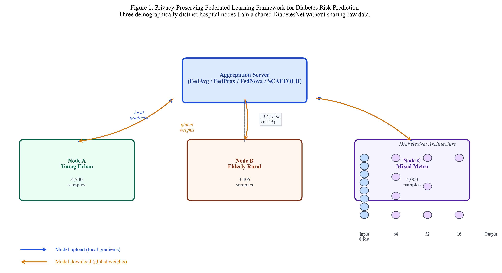

# Privacy-Preserving Federated Learning for Diabetes Risk Prediction

What if hospitals could collaborate on a shared diabetes model without sharing a single patient record?

[](https://www.python.org)
[](https://pytorch.org)
[](https://flower.dev)
[](https://opacus.ai)
[](LICENSE)
[](https://www.journals.elsevier.com/computer-methods-and-programs-in-biomedicine)

**Author:** Rajveer Singh Pall  
**Affiliation:** Gyan Ganga Institute of Technology and Sciences, Jabalpur, India  
**Submitted to:** *Computer Methods and Programs in Biomedicine* (CMPB, Elsevier)

> All commits are solely authored by Rajveer Singh Pall  
> (verified via Insights → Contributors graph).  
> AI coding tools were used locally for development assistance and hold no commit authorship.

---

## Overview

Centralised machine learning for healthcare requires pooling raw patient records across institutions — a practice that conflicts with HIPAA, GDPR, and the practical realities of hospital data governance. This project implements and evaluates a **privacy-preserving federated learning (FL)** framework for type-2 diabetes risk prediction that keeps patient data on-site while enabling multi-institutional collaboration.

Four FL aggregation strategies — **FedAvg**, **FedProx** (μ=0.1), **FedNova** (τ={5,3,4}), and **SCAFFOLD** (Option II) — are trained on demographically partitioned NHANES data and validated externally on **1,282,897 BRFSS respondents**, the largest independent validation reported for this task. Beyond discrimination (AUC), the study evaluates **demographic fairness** (elderly–young AUC gap), **calibration** (Platt, isotonic, temperature scaling on FedAvg and FedProx), and the **differential privacy–utility tradeoff** (DP-SGD, ε ∈ {0.5, 1, 2, 5, 10, 20, 50, 100, ∞}).

**0.757 AUC · 1.28M external patients · 40% narrower generalisation gap · ECE 0.276→0.001**

> [!IMPORTANT]
> The primary finding is not raw AUC gain. FedAvg's generalisation gap (internal→external AUC drop) is **40% smaller** than a matched centralised DiabetesNet (0.031 vs. 0.052), suggesting federation produces a qualitatively more population-robust model — not merely a higher-scoring one. A sample-matched sensitivity analysis (n=11,906) shows a gap of 0.024, indicating that data composition partially contributes; federation additionally provides privacy preservation, improved elderly fairness, and operational feasibility under regulatory constraints.

---

## Results at a Glance

### Discrimination — Internal (NHANES) and External (BRFSS) Validation

| Model | Internal AUC [95% CI] | External AUC [95% CI] | Gen. Gap | Elderly Gap [95% CI] | Brier [95% CI] |
|:---|:---:|:---:|:---:|:---:|:---:|
| Centralised XGBoost | 0.769 [0.760–0.777] | 0.700 [0.698–0.701] | 0.069 | 0.069 [0.062–0.076] | 0.322 [0.321–0.322] |
| Centralised DiabetesNet | 0.801 | 0.749 [0.748–0.750] | 0.052 | — | 0.306 [0.305–0.306] |
| **FedAvg** ⭐ | **0.788 [0.780–0.796]** | **0.757 [0.756–0.758]** | **0.031** | **0.054 [0.047–0.060]** | **0.217 [0.217–0.218]** |
| FedProx (μ=0.1) | 0.785 [0.777–0.793] | 0.752 [0.751–0.753] | 0.033 | 0.066 [0.059–0.073] | 0.242 [0.241–0.242] |
| FedNova (τ={5,3,4}) | 0.786 [0.778–0.794] | 0.744 [0.743–0.745] | 0.042 | 0.064 [0.058–0.071] | 0.266 [0.266–0.267] |
| SCAFFOLD (SGD, 50 rds)† | 0.642 [0.631–0.653] | 0.665 [0.664–0.667] | −0.023‡ | −0.092 [−0.099–−0.085]§ | 0.187 [0.187–0.187] |

Gen. Gap = Internal AUC − External AUC (lower is better).  
Internal CIs: stratified bootstrap (N=2,000, n=15,650). External CIs: DeLong structural components estimator (n=1,282,897).  
All pairwise FL strategy DeLong tests statistically significant at Bonferroni-corrected α=0.017.  
† SCAFFOLD uses SGD (required by theory); AdamW-based strategies are not directly comparable on the optimiser dimension.  
‡ SCAFFOLD Gen. Gap is negative (external > internal) due to SGD convergence dynamics, not a genuine generalisation advantage.  
§ SCAFFOLD elderly–young gap is negative (elderly AUC > young AUC); this reflects near-random performance on young respondents (AUC=0.521), not improved elderly prediction. See Sections 4.6 and 5.2.

### Calibration — FedAvg on BRFSS External Set (n=1,026,318)

| Method | ECE [95% CI] | AUC | Notes |
|:---|:---:|:---:|:---|
| Uncalibrated | 0.276 [0.276–0.277] | 0.757 | Moderate overconfidence (scores biased high) |
| Platt scaling | 0.007 [0.006–0.008] | 0.757 | Two-parameter sigmoid; robust to small cal sets |
| **Isotonic regression** ⭐ | **0.001 [0.000–0.002]** | 0.757 | Near-perfect calibration |
| Temperature scaling (T=2.41) | 0.269 [0.268–0.270] | 0.757 | Limited benefit; non-monotone logit curve |

FedProx calibration results (uncal ECE=0.319, Platt=0.016, isotonic=0.002) are reported in Supplementary Table S5.

### Differential Privacy Tradeoff

<details>
<summary>Extended DP sweep — ε ∈ {0.5, 1, 2, 5, 10, 20, 50, 100, ∞}</summary>

| ε (target) | AUC | Outcome |
|:---:|:---:|:---|
| 0.5 | 0.500 | Collapse |
| 1.0 | 0.498 | Collapse |
| 2.0 | 0.516 | Collapse |
| 5.0 | 0.500 | Collapse |
| **10.0** | **0.769** | **Recovery boundary** |
| 20.0 | 0.769 | Recovery |
| 50.0 | 0.769 | Recovery |
| 100.0 | 0.769 | Recovery |
| ∞ (no DP) | 0.766 | FedAvg baseline |

Recovery emerges sharply at ε=10 (AUC=0.769). Collapse at ε≤5 reflects the high noise multiplier required at healthcare-scale sampling rates (~5–15%), where per-node sample sizes of 3,000–4,500 cannot absorb tight DP budgets. Opacus RDP accounting returns ε_actual=∞ at ε_target≥10, so ε=10 characterises the utility floor for this dataset-size regime rather than a formal cryptographic guarantee.

</details>

---

## Research Questions

| | Question | Finding |
|:---|:---|:---|
| **RQ1 · Performance** | Does federated training generalise better than centralised? | ✅ FedAvg generalisation gap 40% smaller than matched centralised DiabetesNet (0.031 vs. 0.052); sample-matched sensitivity gap=0.024 indicates partial data-composition contribution |
| **RQ2 · Fairness** | Does federated training reduce demographic AUC disparity? | ✅ Elderly gap: 0.069 → 0.054 (21.7% within-study improvement) |
| **RQ3 · Privacy** | What is the accuracy cost of differential privacy? | ⚠️ Model collapse at ε≤5; recovery at ε≥10 (AUC=0.769); formal DP requires substantially larger per-node cohorts |
| **RQ4 · Calibration** | Are federated risk scores clinically trustworthy? | ✅ ECE 0.276 → 0.001 after isotonic recalibration; Platt scaling reduces ECE to 0.007 with only two parameters |

---

## Architecture



Three demographically distinct hospital nodes (Node A: Young Urban community health clinic, n=4,500; Node B: Elderly Rural critical access hospital, n=3,406; Node C: Mixed Metropolitan academic centre, n=4,000) train local DiabetesNet models (4-layer MLP, BatchNorm, AdamW) and exchange only weight updates with a central aggregator. No raw patient records leave any node.

---

## Repository Structure

```
Federated-Diabetes/
│
├── federated/
│   │
│   ├── ── Core modules ──
│   ├── config_paths.py                          # All hyperparameters and paths
│   ├── nn_model.py                              # DiabetesNet: 4-layer MLP, BatchNorm, AdamW
│   ├── fl_client.py                             # Flower FL client (DiabetesClient)
│   ├── data_utils.py                            # Data loading, preprocessing, node splits
│   │
│   ├── ── Pipeline (run in order) ──
│   ├── 00_fit_global_scaler.py                  # Fit StandardScaler on NHANES training split
│   ├── 01_partition_data.py                     # Partition NHANES into 3 demographically distinct nodes
│   ├── 02_centralised_baseline.py               # XGBoost + centralised DiabetesNet baselines
│   ├── 03_federated_simulation.py               # FedAvg + FedProx (50 rounds, 3 nodes)
│   ├── 03b_fednova_corrected.py                 # FedNova with corrected gradient normalisation
│   ├── 04_differential_privacy.py               # DP-SGD core experiments (ε ∈ {0.5, 1, 2, 5, ∞})
│   ├── 05_fairness_analysis.py                  # Subgroup AUC, fairness gap, equalised odds
│   ├── 06_results_summary.py                    # Consolidated results table
│   ├── 07_external_validation.py                # BRFSS 2020–2022 external validation (n=1.28M)
│   ├── 07_statistical_analysis.py               # Stratified bootstrap + DeLong CIs
│   ├── 08_scaffold_baseline.py                  # SCAFFOLD Option II (Karimireddy et al. ICML 2020)
│   ├── 09_calibration_analysis.py               # Platt / isotonic / temperature scaling + ECE
│   ├── 10_stratified_centralised_experiment.py  # Mechanism analysis (federation vs. composition)
│   ├── 11_subgroup_confidence_intervals.py      # Bootstrap CIs for fairness gap
│   ├── 12_dp_technical_details.py               # RDP accounting tables
│   │
│   ├── ── CMPB extension scripts ──
│   ├── 14_scaffold_external.py                  # SCAFFOLD external BRFSS validation
│   ├── 15_dp_extended.py                        # Extended DP sweep (ε={10,20,50,100})
│   ├── 16_pairwise_delong.py                    # Pairwise DeLong tests (Bonferroni α=0.017)
│   ├── 17_fedavg_calibration.py                 # FedAvg post-hoc calibration (ECE 0.276→0.001)
│   ├── cmpb_experiments.py                      # Bootstrap Brier CIs, NNS, ECE CIs, SCAFFOLD CI
│   │
│   ├── ── Figure generation ──
│   ├── generate_publication_figures.py          # All 8 publication figures (300 dpi)
│   │
│   └── results/
│       ├── auc_confidence_intervals.json        # Bootstrap + DeLong CIs for all models
│       ├── external_validation.json             # BRFSS AUC + subgroup fairness
│       ├── fedavg_calibration_results.json      # FedAvg calibration ECE (CMPB primary)
│       ├── federated_convergence.json           # Round-by-round AUC for FedAvg/FedProx
│       ├── fednova_corrected.json               # FedNova results
│       ├── scaffold_results.json                # SCAFFOLD internal convergence (50 rounds)
│       ├── scaffold_external_results.json       # SCAFFOLD external BRFSS validation
│       ├── dp_results.json                      # DP-SGD results (ε ∈ {0.5,1,2,5,∞})
│       ├── dp_results_extended.json             # Extended DP sweep (ε ∈ {10,20,50,100})
│       ├── pairwise_delong_all.json             # Pairwise DeLong test statistics
│       ├── fairness_metrics.json                # Subgroup AUC + fairness gaps
│       ├── brier_score_cis.json                 # Bootstrap Brier CIs (N=2000, BRFSS)
│       ├── nns_results.json                     # Number Needed to Screen (elderly subgroup)
│       ├── ece_cis.json                         # ECE bootstrap CIs (FedAvg calibration methods)
│       ├── internal_bootstrap_cis.json          # SCAFFOLD internal AUC bootstrap CI
│       └── figures/                             # 8 × 300 dpi publication figures
│           ├── fig1_architecture.png
│           ├── fig2_convergence.png
│           ├── fig3_roc_curves.png
│           ├── fig4_fairness.png
│           ├── fig5_dp_tradeoff.png
│           ├── fig6_calibration.png
│           ├── fig7_generalisation_gap.png
│           └── fig8_summary_comparison.png
│
├── generate_revised_docs.js                     # CMPB manuscript + supplementary generator [ACTIVE]
├── package.json                                 # Node.js dependencies (docx)
├── README.md
├── requirements.txt
├── LICENSE                                      # MIT
└── .gitignore
```

> **Not tracked** (reproducible or sensitive): raw data (`data/`), model weights (`models/`), scaler artefacts (`artefacts/`), prediction arrays (`*.npy`), manuscript DOCX (under review).

---

## Setup

**Prerequisites:** Python 3.10+, Node.js 18+, CUDA-capable GPU recommended (CPU works but is slower).

```bash
git clone https://github.com/Rajveer-code/Federated-Diabetes.git
cd Federated-Diabetes
pip install -r requirements.txt
npm install   # for DOCX generation only
```

**Data acquisition:**

| Dataset | Source | Purpose |
|:---|:---|:---|
| NHANES 2013–2020 | [cdc.gov/nchs/nhanes](https://wwwn.cdc.gov/nchs/nhanes/) | Training (n=15,650) |
| BRFSS 2020–2022 | [cdc.gov/brfss](https://www.cdc.gov/brfss/annual_data/annual_data.htm) | External validation (n=1,282,897) |

Download NHANES XPT files for cycles 2013-14, 2015-16, 2017-18, 2019-20. Features: `RIDAGEYR`, `BMXBMI`, `BPXOSY3`, `LBXGH`, `LBXGLU`, `LBXTC`, `PAQ650`, `SMQ020`, `RIAGENDR`.

For BRFSS external validation, set the path via environment variable:
```bash
# Linux / macOS
export BRFSS_PATH="/path/to/brfss_final.csv"

# Windows (PowerShell)
$env:BRFSS_PATH = "C:\path\to\brfss_final.csv"
```

---

## Reproducing Results

Run scripts in order from the `federated/` directory. Total expected runtime on an RTX 3060+: **~40 minutes** (including CMPB extension scripts).

```bash
cd federated/

# Step 1 — Fit global scaler (MUST run first; prevents data leakage)
python 00_fit_global_scaler.py
# → artefacts/global_nhanes_scaler.joblib

# Step 2 — Partition NHANES into 3 demographically stratified nodes
python 01_partition_data.py
# → data/node_{A,B,C}_{train,val}.csv

# Step 3 — Centralised baselines (~2 min)
python 02_centralised_baseline.py
# → results/centralised_metrics.json

# Step 4 — FedAvg + FedProx simulation (~5 min)
python 03_federated_simulation.py
# → results/federated_convergence.json

# Step 5 — FedNova with corrected gradient normalisation (~5 min)
python 03b_fednova_corrected.py
# → results/fednova_corrected.json

# Step 6 — Differential privacy core experiments (~3 min)
python 04_differential_privacy.py
# → results/dp_results.json

# Step 7 — Fairness analysis (~2 min)
python 05_fairness_analysis.py
# → results/fairness_metrics.json

# Step 8 — Results summary
python 06_results_summary.py

# Step 9 — External validation on BRFSS 2020–2022 (~4 min)
python 07_external_validation.py
# → results/external_validation.json

# Step 10 — Statistical CIs: stratified bootstrap + DeLong (~3 min)
python 07_statistical_analysis.py
# → results/auc_confidence_intervals.json

# Step 11 — SCAFFOLD internal baseline (~1 min)
python 08_scaffold_baseline.py
# → results/scaffold_results.json

# Step 12 — Post-hoc calibration analysis (~2 min)
python 09_calibration_analysis.py
# → results/calibration_results.json

# ── CMPB Extension Scripts ──────────────────────────────────────

# Step 13 — SCAFFOLD external BRFSS validation (~3 min)
python 14_scaffold_external.py
# → results/scaffold_external_results.json

# Step 14 — Extended DP sweep: ε ∈ {10, 20, 50, 100} (~3 min)
python 15_dp_extended.py
# → results/dp_results_extended.json

# Step 15 — Pairwise DeLong tests (Bonferroni α=0.017) (~1 min)
python 16_pairwise_delong.py
# → results/pairwise_delong_all.json

# Step 16 — FedAvg post-hoc calibration (~2 min)
python 17_fedavg_calibration.py
# → results/fedavg_calibration_results.json

# Step 17 — Bootstrap Brier CIs, NNS, ECE CIs, SCAFFOLD bootstrap CI (~5 min)
python cmpb_experiments.py
# → results/brier_score_cis.json, nns_results.json, ece_cis.json, internal_bootstrap_cis.json

# ── Outputs ─────────────────────────────────────────────────────

# Step 18 — Generate all 8 publication figures (300 dpi)
python generate_publication_figures.py
# → results/figures/fig{1..8}_*.png

# Step 19 — Generate CMPB manuscript + supplementary (Node.js)
cd ..
node generate_revised_docs.js
# → FL_Diabetes_CMPB_FINAL_SUBMISSION.docx
# → FL_Diabetes_CMPB_FINAL_with_figures.docx
# → Cover_Letter_CMPB_FINAL.docx
# → FL_Diabetes_Supplementary_CMPB.docx
```

All pre-computed results are committed under `federated/results/` for immediate inspection without running the full pipeline.

---

## Hyperparameters

<details>
<summary>Full hyperparameter table</summary>

All hyperparameters are centralised in `federated/config_paths.py`.

| Parameter | Value | Rationale |
|:---|:---:|:---|
| `FL_NUM_ROUNDS` | 50 | Convergence criterion ΔAUC < 0.001 met by round 38 |
| `NN_LOCAL_EPOCHS` | 5 | Balances convergence speed and communication cost |
| `NN_BATCH_SIZE` | 256 | GPU-optimised; fits 4 GB VRAM for 8-feature input |
| `FedProx μ` | 0.1 | Grid search over {0.01, 0.1, 1.0}; best external AUC |
| `FedNova τ` | {5, 3, 4} | Node-specific local update counts |
| `AdamW lr` | 0.001 | CosineAnnealingLR schedule; η_min = 10⁻⁶ |
| `RANDOM_SEED` | 42 | Fixed across all experiments |
| `DP δ` | 10⁻⁵ | Standard for datasets with n < 10⁶ |
| `DP clipping C` | 1.0 | Gradient clipping norm for DP-SGD |
| `DP batch` | 512 | Sampling rate ≈ 5% per node |

</details>

---

## Key Technical Decisions

### Global Scaler — Preventing Data Leakage
A single `StandardScaler` is fitted **once** on the NHANES training split (`00_fit_global_scaler.py`) and saved as a shared artefact. Every node calls `.transform()` only — never `.fit_transform()`. Fitting separate scalers per node would contaminate evaluation with node-local statistics, invalidating cross-node comparisons.

### DeLong Estimator for Large-Scale CIs
Stratified bootstrap on 1.28 million BRFSS records is computationally intractable (kernel matrix ≈ 708 GB). We use the DeLong structural components estimator — an O(n log n) algorithm via `numpy.searchsorted` — which produces mathematically equivalent 95% CIs in seconds.

### SCAFFOLD with SGD
SCAFFOLD's convergence guarantee (Karimireddy et al., ICML 2020) requires SGD. Our implementation respects this, which means SCAFFOLD is compared against AdamW-based strategies under an inherent optimiser mismatch. The lower internal AUC (0.642 vs. 0.788) and the inverted elderly gap (−0.092) are reported transparently. A matched AdamW-SCAFFOLD ablation is a natural extension.

### Generalisation Gap as Primary Metric
Raw AUC comparisons across different training sets confound data composition effects with model quality. The generalisation gap (internal − external AUC) isolates population robustness. FedAvg's gap (0.031) is 40% smaller than the matched centralised DiabetesNet (0.052); a sample-matched sensitivity analysis (n=11,906) shows a gap of 0.024, indicating that data composition partially explains the advantage. Federation additionally provides privacy preservation, demographic equity, and feasibility under regulatory constraints.

### Number Needed to Screen (NNS)
In the elderly subgroup (age ≥60, prevalence 20.24%), at the Youden-optimal threshold FedAvg achieves NNS=8.6 (sens=0.577, spec=0.672, threshold=0.656) versus XGBoost NNS=8.0 (sens=0.618, spec=0.517, threshold=0.757). At a sensitivity-prioritising threshold of 0.35, both converge to NNS=5.1.

---

## Limitations

- Node partitioning is **simulated** from a single national cohort (NHANES). Real deployments involve genuine between-site batch effects, divergent measurement protocols, and independent patient populations.
- The NHANES composite diabetes outcome (HbA1c ≥6.5% or fasting glucose ≥126 mg/dL or self-report) differs from the BRFSS self-reported-only outcome, attenuating external AUC and introducing measurement error in cross-dataset comparisons.
- SCAFFOLD was evaluated with SGD (required by theory); performance relative to AdamW-based strategies is not directly comparable on the optimiser dimension.
- Tight differential privacy (ε≤5) causes model collapse at per-node sample sizes of ~3,000–4,500. Opacus RDP returns ε_actual=∞ at ε_target≥10; formal DP guarantees require substantially larger per-node cohorts (~40,000), composition mechanisms, or weaker DP notions (local DP, shuffling).
- All nodes share the same DiabetesNet architecture; personalised FL strategies (Ditto, pFedMe) with heterogeneous local models were not evaluated.
- SHAP feature importance analysis is identified as a priority extension; execution requires the NHANES test split arrays (X_test.npy).

---

## Citation

```bibtex
@unpublished{pall2026fl_diabetes,
  title   = {Privacy-Preserving Federated Learning for Diabetes Risk Prediction
             Across Demographically Heterogeneous Hospital Nodes},
  author  = {Pall, Rajveer Singh},
  year    = {2026},
  note    = {Manuscript under review at Computer Methods and Programs in Biomedicine},
  url     = {https://github.com/Rajveer-code/Federated-Diabetes}
}
```

---

## Ethics Statement

- **NHANES** (training data): publicly available, de-identified survey data collected under US federal ethics oversight (NCHS IRB protocol).
- **BRFSS** (external validation): publicly available, de-identified, state-administered telephone survey with CDC oversight.
- No new patient data were collected. Secondary analysis of publicly released, de-identified datasets does not require IRB approval under US federal regulations (45 CFR 46.104).
- All model outputs are for **research purposes only** and do not constitute a validated clinical diagnostic tool.

---

## License

MIT License — see [LICENSE](LICENSE). Free to use, modify, and distribute with attribution.
